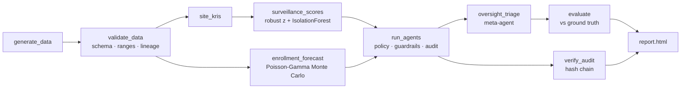
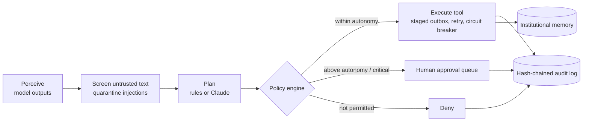

# Agentic Clinical AI

[](https://doi.org/10.5281/zenodo.23851413)

Governed, auditable AI agents for **clinical data surveillance** and **predictive enrollment intelligence**, orchestrated end-to-end with **Snakemake**.

The project is a working reference implementation of the principles in *Understanding Agentic AI in Clinical Development — From Automation to Autonomy, Part 1* (Syneos Health Insights Hub, 2026): bounded autonomy, guardrails by design, traceability, least-privilege agent identities, human approval for high-impact actions, an oversight meta-agent against alert fatigue, and institutional memory across runs.

> All data is **synthetic**. The generator injects known anomalies (data fabrication, poor data quality, late data entry, competitor-driven enrollment collapse, prompt-injection attempts) so every run can be scored against ground truth.

## Quick start

```bash
# option A: pip
pip install -e ".[dev]"
snakemake --cores 4

# option B: conda, managed by Snakemake
snakemake --cores 4 --use-conda
```

Then open `results/demo/report/report.html`.

Other useful commands:

```bash
pytest                                   # unit + integration tests
snakemake -n                             # dry run
snakemake --cores 4 --config run_id=wk31 # a second "weekly" run; memory escalates persistent issues
snakemake --dag | dot -Tsvg > docs/dag.svg
```

## Pipeline



`validate_data` and `verify_audit` are hard gates: the run stops if inputs fail validation or if the audit chain has been altered.

## How the agents work

Each agent runs the same governed loop (`src/agentic_clinical/agents/core.py`):



| Agent | Autonomy | Can do autonomously | Always needs a human |
|---|---|---|---|
| `surveillance_agent` | intermediate | raise data queries, notify, flag sites, schedule targeted SDV | for-cause audit (critical) |
| `enrollment_agent` | basic | notify the study team | enrollment reallocation (high) |

Autonomy levels follow the paper's capability spectrum (minimal → basic → intermediate → advanced) and are set per agent in `config/policies.yaml`, not in code.

### Human-in-the-loop decisions

```bash
python -m agentic_clinical.cli decide --agentsdir results/demo/agents --datadir results/demo/data --list
python -m agentic_clinical.cli decide --agentsdir results/demo/agents --datadir results/demo/data \
    --index 2 --decision approve --approver "Dr. J. Smith (Study Lead)" --reason "Capacity confirmed"
```

Decisions are attributed to `human:<name>` and appended to the same hash chain; approved actions are staged to the outbox. They are also stored in institutional memory: in later runs, a request you rejected, or an identical request you already approved, is not queued again for `agents.decision_memory_days` (default 14). It is listed as "already decided" in the report instead.

### LLM planning (optional)

Set `agents.planner: "anthropic"` in `config/config.yaml` and export `ANTHROPIC_API_KEY`. Claude receives only structured, screened, PII-redacted observations and the agent's tool catalogue; its JSON is strictly parsed and schema-checked, and the policy engine still decides what runs. Any failure falls back to the deterministic rule planner and is logged.

## From the paper to the code

| Paper concept | Implementation |
|---|---|
| Not every problem needs an agent | Statistics do the detection (`models/`); agents only decide *what to do* about findings |
| Start with clarity before coding | Codified rules in each agent's `rule_plan`; validated inputs (`data/quality.py`) |
| Too much autonomy, too soon | Per-agent autonomy levels, action budgets, critical actions always gated |
| Pilot trap / design for federation | Shared tool registry, policy engine, audit and memory used by every agent |
| Dynamic per-agent identities, least privilege | `PolicyEngine` allow-lists per `agent_id` |
| Prompt injection, tool misuse, data spillover | `screen_text`, schema-validated tools, `redact_pii` before any LLM call |
| Cascading failures | `CircuitBreaker` defers remaining work after N consecutive errors |
| ALCOA++, auditability | `agents/audit.py`: attributable, timestamped, hash-chained JSONL + `verify_chain` |
| Oversight fatigue → meta-agents | `agents/oversight.py`: consolidated, ranked queue; approvals and security events never suppressed |
| Make learning institutional | `agents/memory.py`: did / learned / deferred per agent and run; persistent issues escalate |
| Every connection traceable and reversible | Tools write to a staged outbox, committed downstream only after review |
| Show visible value early | `evaluation.py`: precision/recall vs ground truth and alert-reduction stats in every report |

See [`docs/architecture.md`](docs/architecture.md) for more detail.

## Repository layout

```
├── Snakefile                    # entry point; includes workflow/rules/*.smk
├── workflow/rules/              # data, models, agents, report rules
├── config/
│   ├── config.yaml              # study, model and runtime settings
│   └── policies.yaml            # governance: identities, tool risk, autonomy, budgets
├── envs/environment.yml         # conda env used by --use-conda
├── src/agentic_clinical/
│   ├── data/                    # synthetic generator, validation + lineage
│   ├── features.py              # site KRIs
│   ├── models/                  # surveillance scoring, enrollment forecast
│   ├── agents/                  # core loop, guardrails, tools, audit, memory, LLM, agents, oversight
│   ├── evaluation.py            # metrics vs ground truth
│   ├── reporting.py             # self-contained HTML report
│   └── cli.py                   # one sub-command per Snakemake rule
├── tests/                       # pytest suite (guardrails, audit tampering, fallback, breaker, ...)
└── .github/workflows/ci.yml     # lint, tests, dry run, full run, report artifact
```

## Outputs (`results/<run_id>/`)

| Path | Contents |
|---|---|
| `run_config.yaml` | the exact effective config for the run |
| `data/` | synthetic tables + `ground_truth.json` |
| `intermediate/` | validation + lineage, KRIs, site scores, enrollment forecast |
| `agents/audit_log.jsonl` | hash-chained audit trail |
| `agents/outbox.jsonl` | staged actions awaiting downstream commit |
| `agents/approvals.jsonl` | actions waiting for a human decision |
| `agents/review_queue.json` | oversight meta-agent queue and digest |
| `report/report.html`, `report/metrics.json` | run report and detection metrics |

Institutional memory lives at `results/memory/institutional_memory.json` and is shared across runs.

## Extending

New tool: add a `ToolSpec` in `agents/tools.py`, give it a risk tier in `policies.yaml`, and grant it to the agents that need it.
New agent: subclass `Agent`, implement `observe` and `rule_plan` (and optionally `untrusted_texts`), add its identity to `policies.yaml`, and call it from `cmd_agents`.
Real data: replace `generate_data` with an extract rule that writes the same tables; `validate_data` enforces the contract.

## Important

This is a reference implementation, not a validated GxP system. Before any use with real trial data it needs computer-system validation (e.g. 21 CFR Part 11 / EU Annex 11), a formal risk assessment, real identity and access management, and production integrations in place of the staged outbox.
